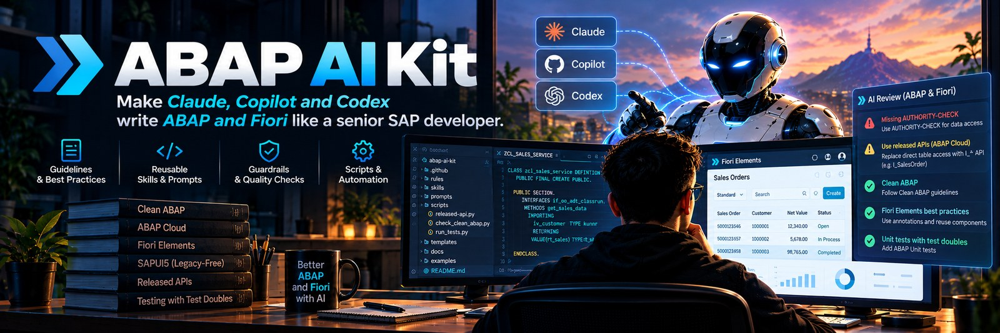

<p align="center"></p>

<h1 align="center">ABAP AI Kit</h1>

<p align="center"><b>Make Claude, Copilot and Codex write ABAP like a senior developer.</b></p>

<p align="center">
Clean ABAP, clean core (levels A-D), ABAP Cloud, independent code review and unit tests with
test doubles: as rules your AI follows on every prompt, with guardrails it cannot skip.
</p>

<p align="center">
<a href="LICENSE"></a>


</p>

---

## Why

AI assistants write ABAP that compiles and still fails review: `SELECT *` on SAP tables in cloud
code, no `AUTHORITY-CHECK`, `sy-subrc` read after a functional call, no tests, syntax that does not
exist on 7.40. This kit gives your assistant the standards a senior ABAP developer applies without
thinking, and checks it cannot talk its way around.

## What changes when the kit is installed

| Situation | What the AI does with the kit | How |
|---|---|---|
| You ask for new code on S/4HANA 2022+ | Writes **ABAP for Cloud Development** (level A) and checks every SAP object it uses; classic only through a documented wrapper | rule + `released-api.py` |
| It wants to read `MARA` | Finds out it is level C and uses the released successor | `released-api.py` (below) |
| You target 7.40 | Writes 7.40 syntax (no `ENUM`, no `RAISE EXCEPTION NEW`), cloud-ready style | `guidelines/abap/development.md`; optional check: abaplint 7.40 config (GitHub Action, `npx`, or ATC) |
| A change is "done" | Only with ABAP Unit tests, test doubles for database / RFC / HTTP, checks green with real counts, and an independent review | definition of done |
| You ask for a review | Findings ranked Blocker / Should fix / Nit, each with file, line and a concrete failure scenario; a read-only reviewer agent gives a second opinion | `abap-code-review` skill + agent, SAP's code review guide |
| It is about to change a system marked read-only, or release a transport | **Blocked** or asks you first, whatever the model decides (Claude Code) | hook `sap-guard.py` |
| It is about to push a secret or an internal name | **Blocked** (Claude Code hook; plus a git pre-push hook for any tool) | `gitleaks-pre-push.py` |

Real output of the clean core look-up (SAP's Cloudification Repository, private cloud / on-premise):

```text
$ python scripts/abap/released-api.py MARA BAPI_USER_GET_DETAIL RFC_READ_TABLE CL_ABAP_RANDOM_INT
MARA [TABL] state=notToBeReleased -> level C (S4CORE LO-MD-MM); successor: I_PRODUCT, I_PRODUCTPROCUREMENT, ...
BAPI_USER_GET_DETAIL [FUNC] state=classicAPI -> level B (SAP_BASIS BC-SEC-USR-ADM)
RFC_READ_TABLE [FUNC] state=noAPI -> level D (SAP_BASIS BC-SEC-AIS-TOO)
CL_ABAP_RANDOM_INT [CLAS] state=released -> level A (SAP_BASIS BC-ABA-LA)
```

## How you use it

You do not call the kit; you talk to your assistant as usual. The kit decides which rules,
guidelines and skills apply to the prompt.

**Every code change ends with the definition of done.** When you ask for new or changed ABAP, the
assistant does not stop at "it compiles":

```text
design  ->  code  ->  ABAP Unit tests with test doubles  ->  checks  ->  independent review  ->  notes
           (cloud first,   (happy path, negative cases,    (syntax, ATC,   (findings with file,     (what was
            released APIs)  the bug as a failing test)       abaplint,      line and failure         learned, ticket
                                                             real counts)   scenario; blockers       state)
                                                                            fixed, checks re-run)
```

If a step cannot be done (no system access, legacy code without seams), the assistant says which
and why instead of skipping it.

**Example prompts and what happens:**

| You write | What the kit makes the assistant do |
|---|---|
| *"Add a method that returns the open items of a customer"* | Designs behind an interface, writes the method for the project's release, adds ABAP Unit tests with a test double for the database access, runs the checks, then runs an independent review before calling it done |
| *"Fix: the export dumps when the table is empty"* | Writes a failing test that reproduces the dump first, fixes it, shows the test passing, reviews the change |
| *"Review this class"* / *"review my transport"* | Collects the change and its goal, checks facts on the system, hands the diff to the read-only `abap-reviewer` agent for a second opinion, reports Blocker / Should fix / Nit with file, line and a concrete failure scenario |
| *"Can I use MARA / BAPI_USER_GET_DETAIL in ABAP Cloud?"* | Runs `released-api.py`: clean core level and the released successor (`I_PRODUCT`) |
| *"Make this report ABAP Cloud ready"* | Uses `abap-cloud-migration`: finds unreleased objects, proposes released replacements or a documented wrapper |
| *"Refactor this method to Clean ABAP"* | Pins the current behaviour with tests first, changes one thing per pass, asks before anything that could change behaviour |
| *"Write unit tests for ZCL_ORDER_SERVICE"* | Extracts seams (interfaces, constructor injection) where needed and writes tests with `cl_abap_testdouble` or local fakes on 7.40 SP08 |
| *"Set up abaplint for this repository"* | Copies the configs from `templates/abaplint/` (7.40 syntax, ABAP Cloud, Clean ABAP) and the pull request workflow |
| *"Start working on ticket ABC-123"* | Reads the ticket, creates the branch with the key, records open points as linked tickets, reports done / partly / decision needed at the end (`work-tracking`) |
| *"Read this spec and tell me what to build"* (a .docx) | Converts it without struck-through text and with the reviewers' comments, files it in the topic folder, lists objects and open questions, maps it to the tickets and proposes missing tasks (`spec-intake`) |
| *"Write the technical documentation for this development"* | Collects the active sources, transport and test results from the system, writes the as-built document in Markdown and builds the .docx on your company template (`tech-doc`) |
| *"Investigate support case 0123456"* | Case folder, every attachment read, known issues searched, root cause with evidence, answer drafted for your approval (`support-case`) |

In Claude Code the independent review runs as a separate read-only agent; in Copilot and Codex
the assistant runs the same checklist itself. The read-only system and secret guards are Claude
Code hooks (plus a git pre-push hook for the secret scan).

## Quickstart (Windows, 2 minutes)

```powershell
git clone https://github.com/catafeidi/abap-ai-kit D:\ai-kit
powershell -ExecutionPolicy Bypass -File D:\ai-kit\scripts\install.ps1
```

Then, in any ABAP project, ask your assistant: *"review this class"*, *"write a unit test with a
test double for this method"*, or *"can I use MARA in ABAP Cloud?"*.

`install.ps1` links the rules, skills, agents and hooks into Claude Code (`~/.claude`), writes the
instructions for GitHub Copilot (`~/.copilot`, VS Code user prompt files) and Codex
(`~/.codex/AGENTS.md`), and can be re-run after every `git pull`. For the hooks, merge the `hooks`
block of `templates/settings.example.json` into `~/.claude/settings.json` once. Needs Python 3 as
`python`.

## Quickstart from your AI chat (you already work with an assistant)

Paste one of these into **Claude Code** or **GitHub Copilot Chat in Agent mode** (both run commands
on your machine; a browser-only chat cannot). Replace the `<...>` parts. Nothing is moved or
deleted: your current folder stays as it is until you delete it yourself.

**Install the kit and bring your current work into it** (the usual first prompt):

```text
Install the ABAP AI Kit on this machine and adopt my current work into it.
1. Clone https://github.com/catafeidi/abap-ai-kit to <D:\ai-kit>, read its README.md and AGENTS.md.
2. Run scripts\install.ps1 -DryRun, show me what it changes, then run it and wire the hooks
   (templates/settings.example.json into ~/.claude/settings.json; install gitleaks if missing).
3. Adopt the folder <C:\path\to\my\work> as project <PROJECTNAME> by following
   guidelines/adopt-project.md: show me the mapping before copying, copy (never move or delete),
   keep my MCP servers, skills, agents and assistant memory working, fill the project AGENTS.md
   from what you find, and ask me only what you cannot find out.
```

**Adopt another folder later** (kit already installed):

```text
Adopt <C:\path\to\other\work> into the ABAP AI Kit as project <PROJECTNAME>,
following %AI_KIT_HOME%\guidelines\adopt-project.md.
```

**Start a project from scratch:**

```text
Set up a new ABAP AI Kit project <PROJECTNAME>: run new-project.ps1, then fill its AGENTS.md by
asking me about the systems, releases, namespace and ticket system.
```

**Update the kit:**

```text
Update the ABAP AI Kit: git pull in %AI_KIT_HOME%, show me what changed, re-run install.ps1.
```

Then start the assistant in the new project folder (`<D:\ai-kit>\<PROJECTNAME>`), so it loads the
project `AGENTS.md`, its MCP servers and its notes.

## What is inside

| Path | What | Loaded |
|---|---|---|
| `AGENTS.md` | Entry point: defaults, rules index, which guideline for which task | Always |
| `rules/` | Short always-on rules: security, decisions, estimation, model choice, sessions and notes, work tracking | Always |
| `guidelines/abap/` | development (cloud first, definition of done), clean-abap, code-review, unit-testing, architecture, security, abap-cloud, sap-systems, adt-vscode-setup | By task |
| `guidelines/` | notes (project folder structure), adopt-project (bring existing work into a project), integrations (GitHub / Azure DevOps, Jira / Azure Boards, Confluence, CI, Salesforce) | By task |
| `skills/` | `clean-abap`, `abap-code-review`, `abap-cloud`, `atc-cloudification`, `abap-cloud-migration`, `sap-abap` (37 SAP cheat sheets), `sap-abap-cds`, `sapui5*`, `sap-fiori-tools`, `sap-cap-capire`, `sap-api-style`, `work-tracking`, `find-information`, `support-case`, `spec-intake`, `tech-doc` | When the prompt matches |
| `agents/abap-reviewer.md` | Read-only independent reviewer | On demand (Claude Code) |
| `hooks/` | Guards: `rm -rf`, `.env` edits, injection shapes, gitleaks before push, read-only SAP systems, transport releases (with tests) | Every tool call |
| `scripts/` | `install.ps1`, `new-project.ps1`, `adt-vscode/setup_adt_vscode.py`, `setup-integrations.py`, `abap/released-api.py`, `docs/docx_to_md.py`, `docs/md_to_docx.py`, `update-references.py` | By you |
| `templates/` | Project skeleton, abaplint configs (7.40, ABAP Cloud, Clean ABAP + GitHub workflow), settings example | By scripts |

Skills load when your prompt matches their description, so they cost nothing until needed.

## Built on

The rules are the kit's own; the knowledge behind them comes from these sources (full list,
licences and pinned commits: `SOURCES.md`, `THIRD-PARTY-NOTICES.md`, `SOURCES.json`):

| Area | Source |
|---|---|
| Style | [Clean ABAP](https://github.com/SAP/styleguides) (SAP, CC-BY-3.0), vendored in full |
| Code review | [SAP ABAP code review guide](https://github.com/SAP/styleguides/tree/main/abap-code-review) (SAP, CC-BY-3.0), vendored |
| Language, OO, design patterns, RAP/EML, ABAP Cloud, unit tests | [SAP ABAP cheat sheets](https://github.com/SAP-samples/abap-cheat-sheets) (SAP, Apache-2.0), 37 sheets vendored |
| Clean core levels A-D, released APIs | [SAP Cloudification Repository](https://github.com/SAP/abap-atc-cr-cv-s4hc) (queried live by `released-api.py`), [SAP clean core white paper](https://www.sap.com/documents/2024/09/20aece06-d87e-0010-bca6-c68f7e60039b.html) |
| ABAP Cloud, ATC cloud readiness, migration | [likweitan/abap-skills](https://github.com/likweitan/abap-skills) (MIT): `abap-cloud`, `atc-cloudification`, `abap-cloud-migration` |
| SAP development references (ABAP, CDS, UI5, Fiori, CAP, API style) | [secondsky/sap-skills](https://github.com/secondsky/sap-skills) (GPL-3.0) |
| RAP architecture | [SAP Flight reference scenario](https://github.com/SAP-samples/abap-platform-refscen-flight), [RAP workshops](https://github.com/SAP-samples/abap-platform-rap-workshops) |
| Object orientation | [SAP abap-oo-basics](https://github.com/SAP-samples/abap-oo-basics), [abap_oo_patterns](https://github.com/SchwarzIT/abap_oo_patterns) |
| Static checks | [abaplint](https://github.com/abaplint/abaplint) (configs in `templates/abaplint/`), [code pal for ABAP](https://github.com/SAP/code-pal-for-abap) |

`python scripts/update-references.py` shows what changed upstream; `--apply` takes it.

## Works with your tools

Each project declares its platforms once in `integrations.json`; the skills `work-tracking`,
`find-information` and `support-case` then use them. You log in yourself; no token goes into a
file. Details and commands: `guidelines/integrations.md`; check a machine with
`python scripts/setup-integrations.py --project <folder>`.

| Area | Supported | Through |
|---|---|---|
| Code, pull requests | GitHub, Azure Repos, GitLab | `gh`, Azure DevOps MCP / `az repos`, `glab` |
| Tickets, boards | Jira, Azure Boards, GitHub Issues | Atlassian MCP, Azure DevOps MCP / `az boards`, `gh` |
| Wiki | Confluence, Azure DevOps Wiki | Atlassian MCP, Azure DevOps MCP |
| CI | GitHub Actions, Azure Pipelines | `gh`, Azure DevOps MCP / `az pipelines` |
| Test management | Azure Test Plans | Azure DevOps MCP |
| Support cases (CRM) | Salesforce | `sf` CLI |
| SAP systems | ADT for VS Code and its MCP server, or an ADT-based MCP server such as vsp | `guidelines/abap/adt-vscode-setup.md`; `sap-guard.py` blocks writes to read-only systems |

Not built yet: Zephyr / Xray test management in Jira, SAP Cloud ALM, ServiceNow. Contributions
welcome (`CONTRIBUTING.md`).

## Projects and personal settings

Project folders sit next to the kit folders and stay out of its Git (whitelist `.gitignore`).
`scripts\new-project.ps1 -Name X` creates one with `AGENTS.md`, notes structure,
`integrations.json` and its own local Git. ABAP Cloud is the default wherever the system offers it;
a project can fix the language version per package.

Personal settings go into `<kit>\local\` (ignored by Git): `identity.md` (who you are, your
language; loaded after `AGENTS.md`), `skills/` (your own skills), `gitleaks-internal.toml` (names of
your employer and customers, so they can never be pushed). `install.ps1` picks them up.

## Contributing

Ideas, fixes and new skills are welcome: see [CONTRIBUTING.md](CONTRIBUTING.md). Good first
contributions: a macOS / Linux `install.sh`, a tested Azure DevOps or GitLab adapter,
before/after examples from real reviews.

## Licence

MIT for the kit's own files; third-party material keeps its licence (CC-BY-3.0, Apache-2.0,
GPL-3.0, MIT), see `THIRD-PARTY-NOTICES.md`. Not affiliated with or endorsed by SAP SE; SAP and
ABAP are trademarks of SAP SE.
